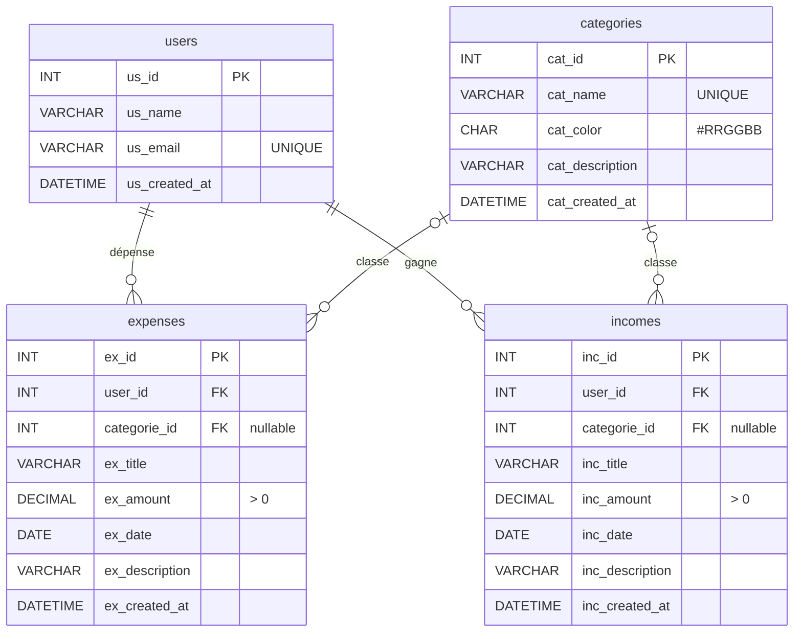

# Backend — guide de dev et de debug

API **FastAPI** (Python) connectée à **MySQL**. Ce fichier résume ce qu'il faut savoir pour développer et déboguer le back.
L'installation complète (Docker, XAMPP) est dans le [README](../README.md).

---

## 1. Organisation des fichiers

```
backend/
├── main.py            # crée l'app FastAPI, configure CORS, inclut les routers, route /api/health
├── database.py        # get_connection() : connexion MySQL avec les infos du .env
├── models.py          # schémas Pydantic (validation des données reçues / renvoyées)
├── routers/           # un fichier par ressource : users.py, categories.py, expenses.py, incomes.py
├── requirements.txt   # dépendances Python
├── Dockerfile         # image Docker de l'API
├── .env.example       # modèle d'identifiants (à copier en .env)
└── .env               # VOS identifiants — jamais commité
```

Base de données : `budget_etudiant` (script : `database/schema.sql`). Chaque colonne est préfixée par sa table (`us_`, `cat_`, `ex_`, `inc_`), sauf les clés étrangères `user_id` et `categorie_id`.



| Relation | Règle |
|---|---|
| `expenses.user_id` / `incomes.user_id` → `users.us_id` | Obligatoire. Supprimer un utilisateur supprime ses dépenses et revenus (`ON DELETE CASCADE`) |
| `expenses.categorie_id` / `incomes.categorie_id` → `categories.cat_id` | Facultatif. Supprimer une catégorie laisse les lignes sans catégorie (`ON DELETE SET NULL`) |

Les catégories sont communes aux dépenses et aux revenus (ex. *Logement* pour une dépense, *Bourse* pour un revenu).

Les colonnes `*_created_at` sont remplies automatiquement par MySQL (`DEFAULT CURRENT_TIMESTAMP`) : ne pas les envoyer dans les `INSERT`.

---

## 2. Lancer l'API

**Avec Docker (recommandé)** — depuis la racine du projet, Docker Desktop lancé :

```bash
docker compose --env-file backend/.env up -d --build
```

**Sans Docker** (base via XAMPP) :

```bash
cd backend
python -m venv venv
venv\Scripts\activate           # Mac/Linux : source venv/bin/activate
pip install -r requirements.txt
uvicorn main:app --reload
```

| URL | Utilité |
|---|---|
| http://localhost:8000/api/health | Vérifie API + MySQL + tables |
| http://localhost:8000/docs | Swagger : tester toutes les routes à la main |

Le code est rechargé automatiquement à chaque sauvegarde (`--reload`), dans Docker comme en local.

---

## 3. Variables d'environnement (`backend/.env`)

| Variable | Valeur par défaut | Remarque |
|---|---|---|
| `DB_HOST` | `localhost` | Forcé à `db` dans Docker (nom du service MySQL) |
| `DB_PORT` | `3306` | Mettre `3307` si le port est déjà pris |
| `DB_USER` | `root` | |
| `DB_PASSWORD` | `budget` | Vide avec XAMPP |
| `DB_NAME` | `budget_etudiant` | |

> ❌ Jamais d'identifiant MySQL écrit dans le code : toujours passer par `get_connection()`.

---

## 4. Ajouter un router (modèle à copier)

Exemple : `backend/routers/categories.py`

```python
from fastapi import APIRouter, HTTPException

from database import get_connection
from models import Category, CategoryIn

router = APIRouter(prefix="/api/categories", tags=["Catégories"])


@router.get("/", response_model=list[Category])
def list_categories():
    conn = get_connection()
    cursor = conn.cursor(dictionary=True)   # renvoie des dict {"cat_id": 1, "cat_name": ...}
    cursor.execute(
        "SELECT cat_id, cat_name, cat_color, cat_description, cat_created_at "
        "FROM categories ORDER BY cat_name"
    )
    rows = cursor.fetchall()
    cursor.close()
    conn.close()
    return rows


@router.post("/", response_model=Category, status_code=201)
def create_category(category: CategoryIn):
    conn = get_connection()
    cursor = conn.cursor(dictionary=True)
    cursor.execute(
        "INSERT INTO categories (cat_name, cat_color, cat_description) VALUES (%s, %s, %s)",
        (category.cat_name, category.cat_color, category.cat_description),
    )
    conn.commit()                           # obligatoire pour INSERT / UPDATE / DELETE
    # On relit la ligne pour renvoyer aussi cat_id et cat_created_at
    cursor.execute("SELECT * FROM categories WHERE cat_id = %s", (cursor.lastrowid,))
    row = cursor.fetchone()
    cursor.close()
    conn.close()
    return row


@router.delete("/{cat_id}", status_code=204)
def delete_category(cat_id: int):
    conn = get_connection()
    cursor = conn.cursor()
    cursor.execute("DELETE FROM categories WHERE cat_id = %s", (cat_id,))
    conn.commit()
    deleted = cursor.rowcount
    cursor.close()
    conn.close()
    if deleted == 0:
        raise HTTPException(status_code=404, detail="Catégorie introuvable")
```

Pour les dépenses, on récupère souvent le nom et la couleur de la catégorie avec une jointure :

```sql
SELECT e.*, c.cat_name, c.cat_color
FROM expenses e
LEFT JOIN categories c ON c.cat_id = e.categorie_id
WHERE e.user_id = %s
ORDER BY e.ex_date DESC
```

Pour le tableau de bord, le solde d'un utilisateur = total des revenus − total des dépenses :

```sql
SELECT
  (SELECT COALESCE(SUM(inc_amount), 0) FROM incomes  WHERE user_id = %s) AS total_revenus,
  (SELECT COALESCE(SUM(ex_amount),  0) FROM expenses WHERE user_id = %s) AS total_depenses
```

Ajouter `AND MONTH(ex_date) = MONTH(CURDATE()) AND YEAR(ex_date) = YEAR(CURDATE())` (idem avec `inc_date`) pour ne garder que le mois en cours.

Puis inclure le router dans `main.py` :

```python
from routers import categories
app.include_router(categories.router)
```

### Règles à respecter

- **Toujours des requêtes paramétrées** : `"... WHERE id = %s", (id,)`. Jamais de f-string dans le SQL (injection SQL).
- **`conn.commit()`** après chaque `INSERT`, `UPDATE`, `DELETE`, sinon rien n'est enregistré.
- **`cursor(dictionary=True)`** pour les `SELECT` : FastAPI renvoie directement des objets JSON.
- **Fermer** le curseur et la connexion à la fin de chaque route.
- Toutes les routes commencent par **`/api/...`** et utilisent les schémas de `models.py`.
- Codes HTTP : `200` lecture, `201` création, `204` suppression, `404` introuvable, `422` données invalides (géré automatiquement par Pydantic).

---

## 5. Tester

1. Ouvrir http://localhost:8000/docs
2. Choisir une route → **Try it out** → remplir → **Execute**
3. Vérifier le code HTTP et la réponse
4. Contrôler en base si besoin :

```bash
docker exec -it budget-mysql mysql -uroot -p budget_etudiant
```
```sql
SELECT * FROM expenses;
```

Avant chaque Pull Request : tester **toutes** les routes modifiées dans `/docs`, et lancer `pytest` (aussi lancé par la CI).

Tests automatiques (`backend/tests/`) : `conftest.py` remplace MySQL par une fausse base (`FakeDB`). Dans chaque test, `fake_db.responses` donne à l'avance le résultat de chaque requête SQL, dans l'ordre. Les dépenses et les revenus sont testés ensemble dans `test_money.py`, car ils partagent le même code (`routers/common.py`).

---

## 6. Debug

### Où regarder

| Problème | Commande |
|---|---|
| Erreur Python, route qui plante (500) | `docker compose logs -f api` |
| Erreur MySQL | `docker compose logs -f db` |
| Les conteneurs tournent ? | `docker ps` |
| Redémarrer l'API | `docker compose restart api` |

Sans Docker, les erreurs s'affichent directement dans le terminal où tourne `uvicorn`.
Astuce : un `print(...)` dans une route apparaît dans ces logs.

### Erreurs fréquentes

| Erreur | Cause | Solution |
|---|---|---|
| `failed to connect to the docker API ... dockerDesktopLinuxEngine` | Docker Desktop n'est pas lancé | Ouvrir Docker Desktop, attendre « Engine running » |
| `Can't connect to MySQL server` | MySQL pas démarrée / encore en initialisation | Attendre 30 s, vérifier `docker ps` et `docker compose logs db` |
| `Access denied for user 'root'` | Mauvais mot de passe dans `.env` | Corriger `.env` ; avec Docker : `docker compose down -v` puis relancer (⚠️ efface la base) |
| `Unknown database 'budget_etudiant'` / `Table ... doesn't exist` | Script SQL pas importé | Docker : `docker compose down -v` puis relancer ; XAMPP : réimporter `schema.sql` |
| `ModuleNotFoundError` | Dépendance manquante | L'ajouter à `requirements.txt` puis relancer avec `--build` |
| `422 Unprocessable Entity` | Le JSON envoyé ne correspond pas au schéma Pydantic | Lire le `detail` de la réponse : il indique le champ en cause |
| Erreur **CORS** dans la console du navigateur | Front pas sur `http://localhost:5173` | Vérifier l'URL du front ou ajouter l'origine dans `allow_origins` (`main.py`) |
| Route en **404** alors qu'elle existe | Router pas inclus dans `main.py` ou mauvais préfixe | Vérifier `app.include_router(...)` et le `prefix` |
| `address already in use` / port 8000 pris | Une autre API tourne déjà | Arrêter l'uvicorn local (Ctrl+C) ou le conteneur |
| Modification de `schema.sql` ignorée | Docker n'exécute le script qu'au premier lancement | `docker compose down -v` puis relancer (⚠️ efface la base) |

---

## 7. Git côté back

- Une branche par fonctionnalité : `feature/crud-expenses`, `feature/crud-categories`…
- Commits courts en français à l'impératif : `Ajoute la route POST /api/expenses`
- Si vous modifiez la structure de la base : mettre à jour `database/schema.sql` **et** `models.py` dans la même PR, et prévenir l'équipe (chacun doit réinitialiser sa base).
- Jamais commiter : `.env`, `venv/`, `__pycache__/` (déjà dans le `.gitignore`).
